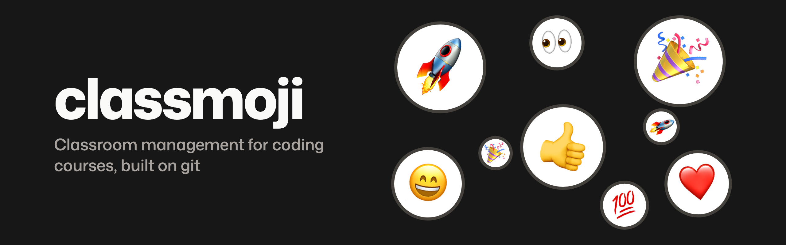
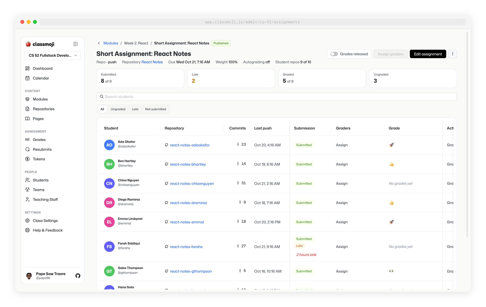

### Classroom management for coding courses, built on git

[Website](https://classmoji.io) | [Docs](https://classmoji.io/docs) | [Issues](https://github.com/classmoji/classmoji/issues) | [Self-hosting](https://classmoji.io/docs/self-hosting/docker)

## About Classmoji

Students use git for every assignment, the way developers actually work. Instructors get repositories, quizzes, pages, slides and grading in one open-source app.

## Key features

- **[Assignments on Github or Gitlab](https://classmoji.io/docs/instructors/repositories)** - a repository per student or team, submitted by push or by closing an issue
- **[Autograding](https://classmoji.io/docs/instructors/autograding)** - tests run in Github Actions, results shown next to each submission
- **AI quizzes** - generated and graded with Claude, optionally reading the student's code
- **[Pages](https://classmoji.io/docs/instructors/pages) and slides** - course pages and Reveal.js decks, co-edited live
- **[Grading](https://classmoji.io/docs/instructors/grading)** - emoji or numeric scales, a page per assignment and a gradebook
- **[Ask Moji](https://classmoji.io/docs/instructors/ask-moji)** - a course assistant that answers from your class materials
- **[MCP server](https://classmoji.io/docs/instructors/mcp-server)** - everything in the app, available to AI clients

## Getting started

Sign in at [classmoji.io](https://classmoji.io) and create a classroom. See [Create a classroom](https://classmoji.io/docs/instructors/create-classroom).

## Self-hosting

- [Docker guide](https://classmoji.io/docs/self-hosting/docker)
- [Environment variables](https://classmoji.io/docs/self-hosting/environment-variables)

## Contributing

Contributions are welcome, especially from students. See [CONTRIBUTING.md](./CONTRIBUTING.md), the [local development guide](https://classmoji.io/docs/open-source/local-development) and the [Code of Conduct](./CODE_OF_CONDUCT.md).

## Supported by

  
  &nbsp;&nbsp;&nbsp;&nbsp;
  
   
  Background jobs powered by <a href="https://trigger.dev">Trigger.dev</a>. Postgres powered by <a href="https://neon.com">Neon</a>.

